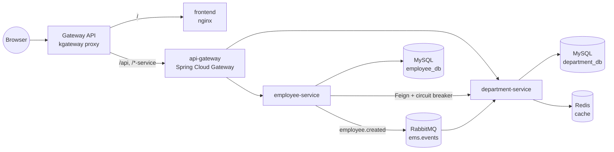
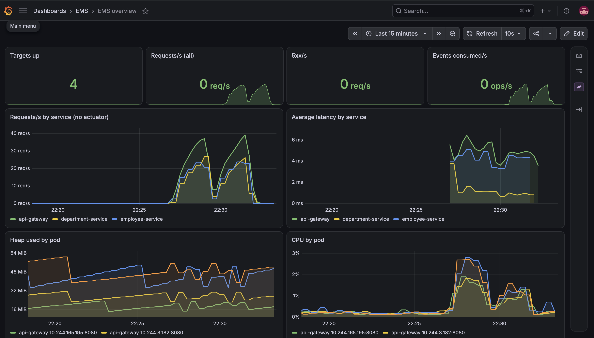
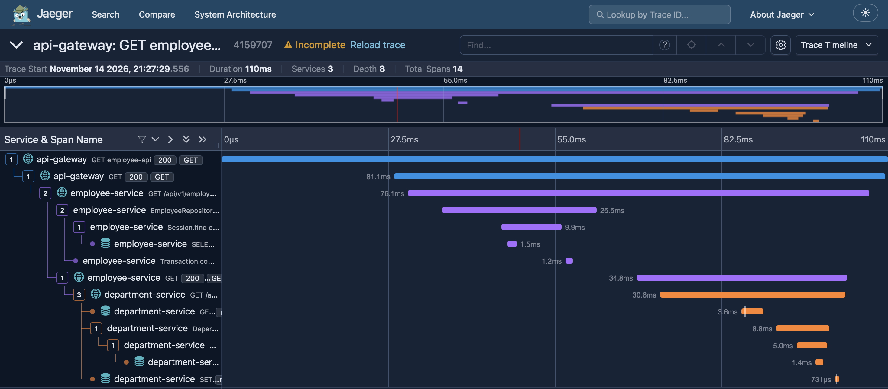

# Employee Management System (EMS) on Kubernetes

Spring Boot microservices (employees, departments, API gateway, React frontend) running on a three-node **kubeadm** cluster on a laptop. The cluster has a Helm chart, Kustomize overlays, Gateway API, KEDA, NetworkPolicies, Pod Security `restricted`, RBAC users, Prometheus/Grafana, OpenTelemetry tracing, a 22-incident [runbook](docs/runbook.md), and an [architecture atlas](docs/diagrams.md) with 24 diagrams.

This branch (`k8s-native`) is the rewrite. [`main`](https://github.com/UchihaIthachi/EMS/tree/main) is the earlier version.

## Before → after

| | `main` (before) | `k8s-native` (this branch) |
|---|---|---|
| Service discovery | Eureka server | Kubernetes Services and DNS |
| Configuration | Spring Cloud Config server, Git repo with a token | Environment variables from ConfigMaps and Secrets |
| Edge | Spring Cloud Gateway only | Gateway API (`Gateway` + `HTTPRoute`, kgateway) → Spring Cloud Gateway |
| Logs | Logstash appender, so nothing reached stdout | stdout (`kubectl logs`) |
| Tracing | Sleuth + Zipkin | OpenTelemetry Java agent → Jaeger v2 (off by default) |
| Async work | RabbitMQ dependency, no producer or consumer | `employee.created` event → idempotent consumer, retries, DLQ, CQRS read model |
| Resilience | — | Resilience4j circuit breaker + time limiter + fallback on the Feign call |
| Caching | — | Redis cache-aside with TTL, evict on write, fail-open |
| Delivery | Jenkinsfile, `:latest` images | GitHub Actions → multi-arch images on GHCR, tagged by commit SHA |
| Kubernetes | Raw manifests that crash-looped on a real cluster (runbook 1) | Helm chart + Kustomize overlays, verified on kubeadm v1.37 |

The stack is Spring Boot 2.7.17, Spring Cloud 2021.0.8 and Java 17. A Boot 3 upgrade is a separate step.

## Architecture



There's one MySQL server with two databases and one user per service. The full design, with requirements, data and event model, every Kubernetes object, the NetworkPolicy matrix, RBAC and resource budget, is in [docs/design.md](docs/design.md). Patterns and failure modes are in [docs/architecture.md](docs/architecture.md). Every flow (circuit breaker, cache-aside, DLQ, idempotent consumer, HPA/KEDA, rollout, delivery, security) is drawn in [docs/diagrams.md](docs/diagrams.md). The same diagrams are built into an interactive web page, with a circuit-breaker simulator and HPA/KEDA calculators: run `python3 docs/site/build.py`, then open `docs/site/dist/index.html`. The `atlas-pages` workflow publishes it to GitHub Pages. The API is described in [API_DOC.md](API_DOC.md).

## What runs where

**Lab cluster:** three Lima VMs on a 16 GB Mac (2.5 / 3 / 3 GB).
- kubeadm, installed at v1.36.6 and upgraded to **v1.37.2**
- Calico, metrics-server, local-path storage
- Gateway API v1.7 with kgateway v2.5
- KEDA

**Namespace `ems`:**

| Object | Used for |
|---|---|
| Deployments + Services | api-gateway (2), employee-service, department-service, frontend, redis |
| StatefulSets + PVCs | MySQL 8.4, RabbitMQ 3.13 |
| HPA | employee-service on CPU |
| KEDA `ScaledObject` | department-service on RabbitMQ queue length |
| PDB, topology spread, PriorityClasses | availability during drains and node loss |
| ResourceQuota, LimitRange | 9 pods use 2.1 Gi of the 4 Gi memory quota |
| NetworkPolicies | default deny + one allow per flow (DNS, metrics scrape, tracing) |
| Pod Security | `restricted` enforced on the namespace |
| RBAC | one ServiceAccount per workload; `ems-developer` and `ems-operator` users through CSRs |
| CronJob | `mysqldump` to a PVC at 02:00, keeps 7 |

## Run it

**On the lab cluster.** It waits for CI images for `HEAD`, then installs the chart and runs a smoke test through the Gateway:

```bash
cp deploy/helm/ems/secrets.local.yaml.example deploy/helm/ems/secrets.local.yaml   # set passwords
bash deploy/lab-deploy.sh
kubectl -n ems port-forward svc/ems 18080:80    # http://127.0.0.1:18080/
```

The smoke test checks:
- the frontend loads
- creating a duplicate department returns 409
- the department cache answers
- an employee is created and read, including its department through Feign
- the `employee.created` event raises the department's stats

**With Kustomize instead of Helm:**

```bash
cp deploy/kustomize/base/secrets.env.example deploy/kustomize/base/secrets.env
bash deploy/kustomize/verify.sh     # renders lab + full overlays, diffs lab against the cluster
```

The `full` overlay is for a bigger cluster: 3 api-gateways, HPA 2–6, KEDA 2–8, 12/16 Gi quota.

**Without Kubernetes:**

```bash
cd deploy/compose && cp .env.example .env && docker compose up -d   # http://127.0.0.1:18080/
```

## Verified behaviour

| Check | Result | Script |
|---|---|---|
| NetworkPolicy | blocked flows time out, allowed flows succeed | `deploy/drills/section-e.sh` |
| Circuit breaker | department-service at 0 → employee GET still 200 with fallback, recovers | `section-e.sh` |
| HPA | employee-service 1 → 2 at 78% CPU under k6 | `section-e.sh` |
| KEDA | department-service 1 → 2 at queue depth 94, drained, DLQ empty | `section-e.sh` |
| PDB during drain | second drain refused, 103/103 requests OK | `section-e.sh` |
| Cluster upgrade | v1.36.6 → v1.37.2 with EMS running | `deploy/drills/upgrade-workers.sh` |
| etcd | snapshot, then restore of a deleted object | manual: `etcdctl snapshot save` / `restore` |
| RBAC | 12/12 `kubectl auth can-i` checks, including `--subresource` | `deploy/drills/rbac-users.sh` |
| Break/fix drills | 9 of 9 | `deploy/drills/runbook-app.sh`, `runbook-node.sh` |
| Metrics | 4 targets; heap and request rate per service | `deploy/observability/metrics.sh` |
| Tracing | one request → one trace: 3 services, 10 spans, 46–70 ms | `deploy/observability/tracing.sh check` |

The tracing request goes gateway → employee-service (with its `SELECT`) → Feign → department-service, where the department comes from the Redis cache, not MySQL.

## Screenshots

**Grafana: EMS overview under k6 load.** This is our own dashboard (`deploy/observability/dashboards/ems-overview.json`). Prometheus scrapes `/actuator/prometheus` on every Spring pod.



**Jaeger: one request, one trace.** It goes gateway → employee-service (with its `SELECT`) → Feign → department-service. This one was a cache miss: Redis `GET`, then `SELECT`, then Redis `SET`.



## Repository layout

```
api-gateway/  employee-service/  department-service/  frontend/   services and Dockerfiles
deploy/helm/ems/          Helm chart (the source of truth)
deploy/kustomize/         base (chart via helmCharts + secretGenerator), overlays lab and full
deploy/lab-deploy.sh      install/upgrade + smoke test
deploy/drills/            section E checks, upgrade, RBAC, runbook drills
deploy/observability/     Prometheus + Grafana, Jaeger + OTel agent
deploy/compose/           local run without Kubernetes
loadtest/k6/              load profiles (PROFILE=drill)
docs/                     design, architecture, diagrams atlas, runbook
docs/site/                atlas web page generator (GitHub Pages)
.github/workflows/ci.yml  multi-arch images to GHCR
```

## Not done yet

- Spring Boot 3 and Micrometer Tracing (replacing the agent).
- Loki for logs (left out for memory).
- An HA control plane: the lab has one control-plane node, and stacked versus external etcd is documented only.
