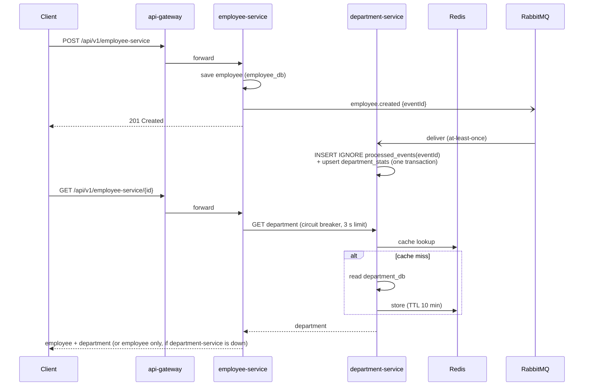

# EMS on Kubernetes: system design

Employee Management System rebuilt as a Kubernetes-native platform project. The domain is small on
purpose; the point is how it runs: discovery, configuration, resilience, events, scaling and operations.

## Architecture

```mermaid
flowchart TB
  user([Browser]) --> gw
  ops([Operator]) -.-> obs
  ci[GitHub Actions] -->|multi-arch images| ghcr[(GHCR)]
  ghcr -.->|pull| cluster

  subgraph cluster[Kubernetes cluster: kubeadm, 3 nodes, Calico]
    subgraph edge[Edge]
      gw[Gateway API<br/>kgateway / Envoy]
      fe[frontend<br/>nginx + React]
      ag[api-gateway<br/>Spring Cloud Gateway]
    end
    subgraph apps[Services]
      es[employee-service<br/>circuit breaker, HPA]
      ds[department-service<br/>cache-aside, idempotent consumer, KEDA]
    end
    subgraph data[Data]
      edb[(MySQL<br/>employee_db)]
      mq{{RabbitMQ<br/>ems.events + DLQ}}
      ddb[(MySQL<br/>department_db)]
      redis[(Redis<br/>cache)]
    end
    subgraph platform[Platform]
      keda[KEDA]
      hpa[HPA + metrics-server]
      sc[local-path StorageClass]
    end
    subgraph obs[Observability: demo only]
      prom[Prometheus + Grafana]
      jaeger[Jaeger via OpenTelemetry]
      loki[Loki]
    end
  end

  gw -->|/| fe
  gw -->|/api, service prefixes| ag
  ag --> es
  ag --> ds
  es -->|Feign + breaker + fallback| ds
  es --> edb
  es -. employee.created .-> mq
  mq -. at-least-once .-> ds
  ds --> ddb
  ds --> redis
  keda -.->|queue length| mq
  keda -.->|scale| ds
  hpa -.->|CPU| es
  prom -.->|scrape /actuator/prometheus| apps
```

## Request and event flow



## Patterns used

| Pattern | Where | Why |
|---|---|---|
| API gateway | Gateway API (kgateway) at the edge, Spring Cloud Gateway for API routing | One entry point; routing and timeouts out of the services |
| Database per service | `employee_db`, `department_db`, separate users | Services own their data; no cross-service joins |
| Platform service discovery | Kubernetes Services + CoreDNS (Eureka removed) | The platform already does registry, DNS and load balancing |
| Externalized configuration | ConfigMaps + Secrets as environment variables (config server removed) | Same image in every environment |
| Health check API | `/actuator/health/liveness`, `/readiness` (DB, RabbitMQ) | Kubernetes restarts dead pods and stops routing to unready ones |
| Circuit breaker, timeout, fallback | Resilience4j on the employee → department call | A slow or failed dependency degrades one field, not the whole request |
| Publish/subscribe events | `employee.created` on a topic exchange | Services stay decoupled; consumers are added without touching the producer |
| Idempotent consumer | `processed_events` keyed by `eventId`, in the same transaction as the update | RabbitMQ delivers at least once; duplicates must not count twice |
| Dead-letter queue | `department.employee-events.dlq` after 3 attempts | Poison messages don't block the queue; they can be inspected and replayed |
| CQRS read model | `department_stats` built from events, `GET /{code}/stats` | Fast reads without querying another service's database |
| Cache-aside | Redis in front of department lookups, TTL + evict on write; Redis failure falls back to MySQL | The hottest read path; the cache is an optimisation, never a dependency |
| Event-driven autoscaling | KEDA on queue length (department-service), HPA on CPU (employee-service) | Scale on the signal that actually measures backlog |
| Graceful shutdown | `server.shutdown=graceful` + PodDisruptionBudgets | Rolling updates and node drains don't drop requests |
| Observability | Prometheus + Grafana, Jaeger via the OpenTelemetry agent, Loki for stdout logs | Installed for short demos only; the lab has ~3.2 GB for apps |

**Deliberately elsewhere:** saga, transactional outbox and idempotency keys for payments are in the
order-and-payments project, where money makes them matter. The employee event here is published
best-effort (a lost event is logged); the outbox pattern is the fix and is shown there.

## Lab sizing

Three Lima VMs on a 16 GB laptop (control plane 2.5 GB, two workers 3 GB). Measured headroom for apps is
about 3.2 GB, so services run one replica each, JVMs are capped at 448 MiB, and Elasticsearch/Kibana are
out of scope.

## Design decisions and trade-offs

**Stateless services.** No service keeps session or request state in memory; everything lives in MySQL,
Redis or RabbitMQ. Any pod can serve any request, so scaling out is just more replicas behind a Service,
and a pod can be killed during a drain or rollout without losing work.

**Static and dynamic content are split.** nginx serves the built React app; the JVMs only serve the API.
Static files never take a JVM thread, and the frontend can later move to a CDN without touching the services.

**REST at the edge, events between services where possible.** The synchronous employee → department call
exists because a GET needs department details right now; it is protected by a timeout, a circuit breaker
and a fallback. Everything that can wait (stats, notifications) goes through RabbitMQ, which removes the
runtime dependency between services.

**Consistency.** Each service is strongly consistent inside its own database. Across services the system is
eventually consistent: `department_stats` can lag `employee_db` by the queue delay. That is acceptable for a
count, and the stats endpoint says so. Nothing here moves money, so there is no saga.

### Failure modes

| Failure | What the user sees | Why |
|---|---|---|
| department-service down or slow | Employee returned without department details | Circuit breaker + 3 s time limit + fallback |
| Redis down | Slightly slower department reads | Cache errors are logged and skipped; MySQL answers |
| RabbitMQ down | Employee saved; stats stop updating; a warning is logged | Publishing is best-effort (outbox would close this gap; see the order-and-payments project) |
| Duplicate delivery after a consumer crash | Nothing | `processed_events` dedupes by `eventId` |
| Malformed or repeatedly failing event | Nothing; it lands in the DLQ | 3 attempts, then dead-lettered |
| One pod crashes | Nothing | Readiness removes it from the Service; the Deployment replaces it |
| Node drained for an upgrade | Nothing | PodDisruptionBudgets + graceful shutdown |
| MySQL down | That service returns errors and goes unready | Database per service limits the blast radius to one service |

### Scaling path (what would change at 100x)

| Pressure | Next step |
|---|---|
| Read-heavy employee/department lookups | More replicas (stateless), Redis already in front of departments; add MySQL read replicas |
| Write volume on one database | Vertical scaling first, then partition by department or tenant |
| Event backlog | KEDA already scales consumers on queue length; move to Kafka if ordering per key or replay is needed |
| Gateway hot spot | Envoy (kgateway) scales horizontally; rate limits per client at the edge |
| Frontend traffic | Serve the static build from a CDN |
| Cross-service reads (e.g. stats) | More CQRS read models fed by events, instead of synchronous fan-out calls |
