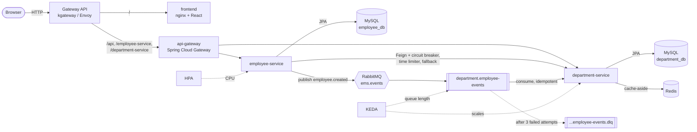
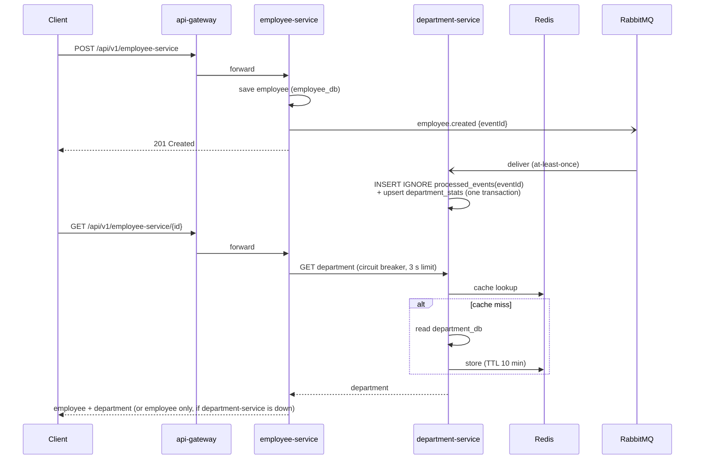

# EMS on Kubernetes: system design

Employee Management System rebuilt as a Kubernetes-native platform project. The domain is small on
purpose; the point is how it runs: discovery, configuration, resilience, events, scaling and operations.

## Architecture

## Request and event flow

## Patterns used

| Pattern | Where | Why |
|---|---|---|
| API gateway | Gateway API (kgateway) at the edge, Spring Cloud Gateway for API routing | One entry point; routing and timeouts out of the services |
| Database per service | `employee_db`, `department_db`, separate users | Services own their data; no cross-service joins |
| Platform service discovery | Kubernetes Services + CoreDNS (Eureka removed) | The platform already does registry, DNS and load balancing |
| Externalized configuration | ConfigMaps + Secrets as environment variables (config server removed) | Same image in every environment |
| Health check API | `/actuator/health/liveness`, `/readiness` (DB, RabbitMQ) | Kubernetes restarts dead pods and stops routing to unready ones |
| Circuit breaker, timeout, fallback | Resilience4j on the employee → department call | A slow or failed dependency degrades one field, not the whole request |
| Publish/subscribe events | `employee.created` on a topic exchange | Services stay decoupled; consumers are added without touching the producer |
| Idempotent consumer | `processed_events` keyed by `eventId`, in the same transaction as the update | RabbitMQ delivers at least once; duplicates must not count twice |
| Dead-letter queue | `department.employee-events.dlq` after 3 attempts | Poison messages don't block the queue; they can be inspected and replayed |
| CQRS read model | `department_stats` built from events, `GET /{code}/stats` | Fast reads without querying another service's database |
| Cache-aside | Redis in front of department lookups, TTL + evict on write; Redis failure falls back to MySQL | The hottest read path; the cache is an optimisation, never a dependency |
| Event-driven autoscaling | KEDA on queue length (department-service), HPA on CPU (employee-service) | Scale on the signal that actually measures backlog |
| Graceful shutdown | `server.shutdown=graceful` + PodDisruptionBudgets | Rolling updates and node drains don't drop requests |
| Observability | Prometheus metrics, stdout logs, OpenTelemetry agent (off by default) | Lab-sized: tracing is switched on for demos only |

**Deliberately elsewhere:** saga, transactional outbox and idempotency keys for payments are in the
order-and-payments project, where money makes them matter. The employee event here is published
best-effort (a lost event is logged); the outbox pattern is the fix and is shown there.

## Lab sizing

Three Lima VMs on a 16 GB laptop (control plane 2.5 GB, two workers 3 GB). Measured headroom for apps is
about 3.2 GB, so services run one replica each, JVMs are capped at 448 MiB, and Elasticsearch/Kibana are
out of scope.
