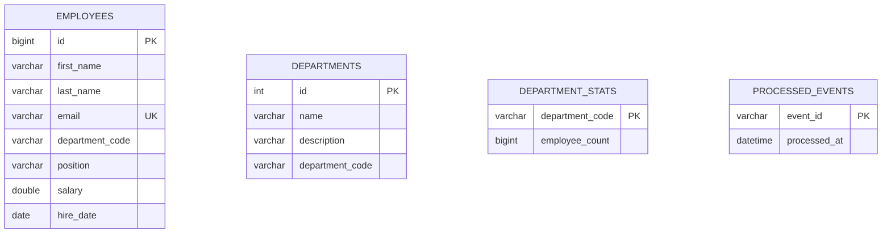
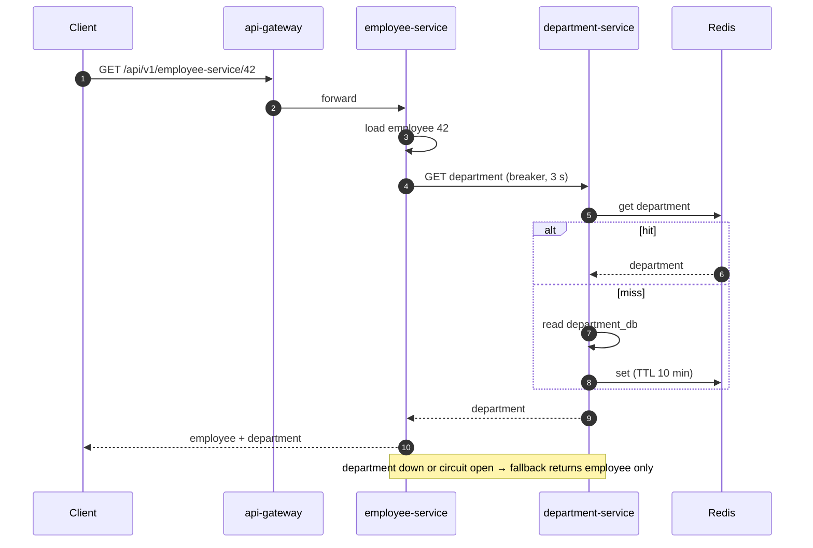
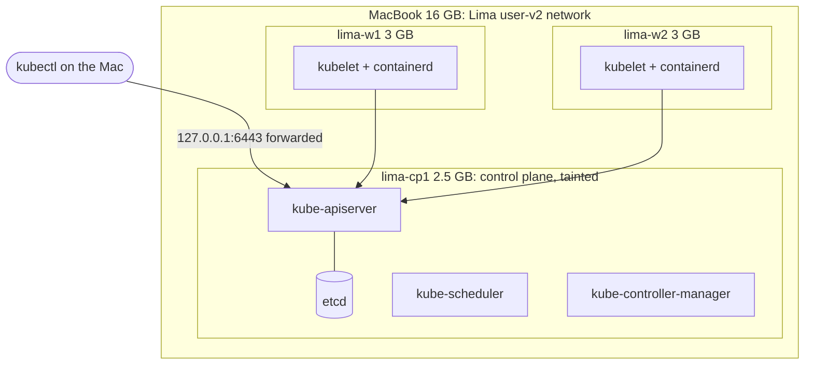
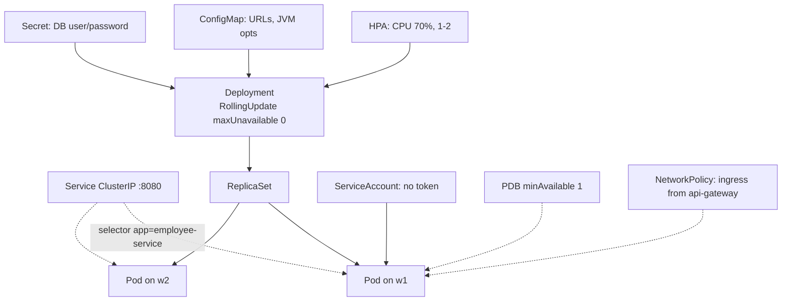
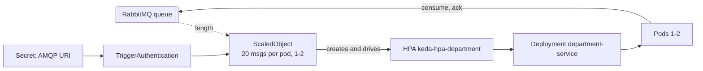
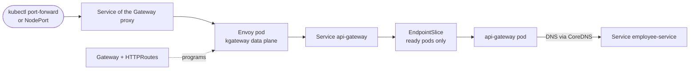
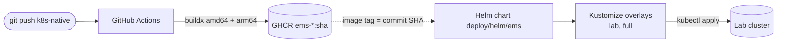

# EMS on Kubernetes: design document

Status: design locked 14 Nov 2026, implementation on branch `k8s-native`.
Related: [architecture.md](architecture.md) (overview, patterns, trade-offs).

## 1. Goals and scope

**Goal.** Run a small employee/department system the way a production platform would: discovered by the
platform, configured from outside the image, resilient to dependency failures, scaled on the right signal,
secured by default, backed up, and upgraded without downtime.

**In scope:** api-gateway, employee-service, department-service, frontend, MySQL, RabbitMQ, Redis; a
3-node kubeadm cluster; Helm chart + Kustomize overlays; HPA and KEDA; NetworkPolicies; RBAC; backups;
cluster upgrade; a runbook of 15 induced failures.

**Out of scope:** multi-region, Elasticsearch/Kibana, a service mesh, sagas (covered in the
order-and-payments project), authentication of end users.

## 2. Requirements

| Type | Requirement |
|---|---|
| Functional | Create/read departments; create/read employees with their department; department stats |
| Availability | One pod or one worker node can fail without user-visible errors for reads |
| Degradation | department-service down → employees still returned (without department) |
| Latency | p95 < 800 ms through the gateway at 20 virtual users (k6) |
| Delivery | Events at-least-once; duplicates have no effect; poison messages are parked |
| Capacity | Whole app ≤ ~3.2 GB RAM across two 3 GB workers |
| Security | Default-deny network, non-root containers, no secrets in Git, least-privilege RBAC |
| Operability | Probes on every pod, stdout logs, Prometheus metrics, one-command deploy |

## 3. High-level architecture

```mermaid
flowchart LR
  user([Browser]) --> gw[Gateway API<br/>kgateway]
  gw -->|/| fe[frontend]
  gw -->|/api, prefixes| ag[api-gateway]
  ag --> es[employee-service]
  ag --> ds[department-service]
  es -->|Feign + circuit breaker| ds
  es --> edb[(employee_db)]
  ds --> ddb[(department_db)]
  ds --> redis[(Redis)]
  es -. employee.created .-> mq{{RabbitMQ}}
  mq -. consume .-> ds
  mq -. 3 failures .-> dlq[[DLQ]]
```

| Component | Tech | Responsibility | Scales on |
|---|---|---|---|
| Gateway | Gateway API, kgateway (Envoy) | Edge routing, single entry point | replicas |
| frontend | nginx + React build | Static UI | replicas |
| api-gateway | Spring Cloud Gateway | API routes, backend timeouts | replicas |
| employee-service | Spring Boot 2.7, JPA, Feign, Resilience4j | Employees; publishes events | HPA (CPU) |
| department-service | Spring Boot 2.7, JPA, Redis cache, AMQP | Departments; consumes events; stats read model | KEDA (queue) |
| MySQL | MySQL 8, one instance, two databases | Persistence per service | vertical |
| RabbitMQ | RabbitMQ 3 | Events, DLQ | vertical |
| Redis | Redis 7, no persistence | Department cache | vertical |

## 4. Data design



- `employees` lives in `employee_db`; the other three tables in `department_db`. No cross-database joins;
  `department_code` is a reference by value.
- `department_stats` is a read model built from events (eventually consistent).
- `processed_events` is the idempotency ledger for the consumer.
- Each database has its own user with grants on that database only.

## 5. API design

| Method | Path (through the gateway) | Service | Notes |
|---|---|---|---|
| POST | `/api/v1/department-controller` | department | Evicts the cache entry for the code |
| GET | `/api/v1/department-controller/{code}` | department | Cache-aside (Redis, TTL 10 min); 404 if unknown |
| GET | `/api/v1/department-controller/{code}/stats` | department | Read model; eventually consistent |
| POST | `/api/v1/employee-service` | employee | Saves, then publishes `employee.created` |
| GET | `/api/v1/employee-service/{id}` | employee | Calls department through the circuit breaker |
| GET | `/employee-service/**`, `/department-service/**` | both | Frontend prefixes, stripped by the gateway |
| GET | `/actuator/health/{liveness,readiness}`, `/actuator/prometheus` | all | Probes and metrics (not routed externally) |

## 6. Event design

| Item | Value |
|---|---|
| Exchange | `ems.events` (topic, durable) |
| Routing key | `employee.created` |
| Queue | `department.employee-events` (durable, dead-letters to `ems.events.dlx`) |
| DLQ | `department.employee-events.dlq` |
| Payload | `{eventId, employeeId, email, departmentCode, occurredAt}` (JSON) |
| Producer guarantee | Best-effort (logged on failure); outbox shown in another project |
| Consumer guarantee | At-least-once delivery, idempotent by `eventId`, 3 attempts then DLQ |
| Ordering | Not required (counts are commutative) |

## 7. Key flows



```mermaid
sequenceDiagram
  autonumber
  participant E as employee-service
  participant Q as RabbitMQ
  participant D as department-service
  E->>Q: publish employee.created {eventId}
  Q->>D: deliver
  D->>D: BEGIN; INSERT IGNORE processed_events; upsert department_stats; COMMIT
  D-->>Q: ack
  Note over Q,D: redelivery → INSERT IGNORE affects 0 rows → skipped
  Note over Q,D: 3 failures → rejected → DLQ
```

## 8. Kubernetes design

### 8.1 Cluster topology



Every node runs kubelet, containerd, kube-proxy and calico-node. Pod CIDR `10.244.0.0/16`,
Service CIDR `10.96.0.0/12`.

### 8.2 Namespaces

| Namespace | Contents | Pod Security |
|---|---|---|
| `ems` | All EMS workloads | `restricted` (enforce) |
| `kgateway-system` | kgateway controller | default |
| `keda` | KEDA operator, metrics server, webhooks | default |
| `calico-system`, `tigera-operator` | CNI | privileged (needs host access) |
| `kube-system` | CoreDNS, kube-proxy, metrics-server, control plane | privileged |
| `local-path-storage` | Volume provisioner | privileged |
| `observability` (demo only) | Prometheus, Grafana, Jaeger, Loki | baseline |

### 8.3 Objects per workload

| Workload | Kind | Replicas | Service | Scaling | Storage | PDB |
|---|---|---|---|---|---|---|
| frontend | Deployment | 1 (2 in `full`) | ClusterIP :80 | — | — | — |
| api-gateway | Deployment | 2 | ClusterIP :8080 | — | — | minAvailable 1 |
| employee-service | Deployment | 1–2 | ClusterIP :8080 | HPA CPU 70% | — | minAvailable 1 (when ≥ 2) |
| department-service | Deployment | 1–2 | ClusterIP :8080 | KEDA ScaledObject (queue 20/pod) | — | minAvailable 1 (when ≥ 2) |
| mysql | StatefulSet | 1 | headless + ClusterIP :3306 | — | PVC 2 Gi | — |
| rabbitmq | StatefulSet | 1 | headless + ClusterIP :5672, :15672 | — | PVC 1 Gi | — |
| redis | Deployment | 1 | ClusterIP :6379 | — | none (cache) | — |
| mysql-backup | CronJob | daily | — | — | PVC 1 Gi | — |

Supporting objects: one ServiceAccount per workload (token not mounted), one ConfigMap and one Secret per
service, ResourceQuota + LimitRange on `ems`, PriorityClasses `ems-data` (higher) and `ems-app`,
Gateway + HTTPRoutes, NetworkPolicies, KEDA TriggerAuthentication.

### 8.4 Stateless workload anatomy (employee-service)



Pod spec essentials: `startupProbe` (liveness endpoint, up to ~120 s), `livenessProbe`, `readinessProbe`;
requests 384Mi/100m, limit 448Mi memory (no CPU limit); `securityContext` runAsNonRoot 10001,
readOnlyRootFilesystem with an `emptyDir` at `/tmp`, drop ALL capabilities;
`topologySpreadConstraints` across nodes; `preStop` sleep 5 s for endpoint propagation.

### 8.5 Event-driven scaling (department-service)



### 8.6 Stateful workload anatomy (MySQL)

```mermaid
flowchart TB
  hs[Headless Service mysql] -. DNS mysql-0.mysql .-> pod
  sts[StatefulSet mysql, 1 replica] --> pod[Pod mysql-0]
  cmap[ConfigMap: my.cnf, init SQL] --> pod
  sec[Secret: root + 2 users] --> pod
  pod --> pvc[PVC data-mysql-0, 2 Gi]
  pvc --> pv[PV]
  sc[StorageClass local-path<br/>WaitForFirstConsumer] -->|provisions| pv
  pv --> disk[(Worker node disk)]
  cj[CronJob mysql-backup] -->|mysqldump| bpvc[PVC backups 1 Gi]
```

### 8.7 Traffic path



kube-proxy turns each Service into iptables rules; readiness decides which pods appear in the EndpointSlice.

### 8.8 NetworkPolicy matrix (namespace `ems`, default deny ingress and egress)

| From \ To | frontend | api-gateway | employee | department | mysql | rabbitmq | redis |
|---|---|---|---|---|---|---|---|
| kgateway proxy | ✅ 80 | ✅ 8080 | | | | | |
| api-gateway | | | ✅ 8080 | ✅ 8080 | | | |
| employee | | | | ✅ 8080 | ✅ 3306 | ✅ 5672 | |
| department | | | | | ✅ 3306 | ✅ 5672 | ✅ 6379 |
| keda namespace | | | | | | ✅ 15672 | |
| observability (demo) | | ✅ 8080 | ✅ 8080 | ✅ 8080 | | | |

All pods may egress to CoreDNS (`kube-system`, UDP/TCP 53). Everything else is denied.

### 8.9 RBAC

| Subject | Kind | Scope | Permissions |
|---|---|---|---|
| Workload ServiceAccounts | ServiceAccount | `ems` | none (token not mounted) |
| `ems-developer` (user via CSR) | Role + RoleBinding | `ems` | get/list/watch pods, logs, services, deployments; no secrets |
| `ems-operator` (user via CSR) | Role + RoleBinding | `ems` | as developer + scale deployments, rollout restart, exec |
| `mysql-backup` CronJob | ServiceAccount | `ems` | none |
| Cluster admin | built-in | cluster | kubeadm admin.conf, kept off daily use |

### 8.10 Resources and scheduling

| Workload | Request CPU / mem | Limit mem | Priority |
|---|---|---|---|
| api-gateway, employee, department | 100m / 384Mi | 448Mi | `ems-app` |
| frontend | 10m / 16Mi | 64Mi | `ems-app` |
| mysql | 100m / 300Mi | 400Mi | `ems-data` |
| rabbitmq | 50m / 160Mi | 256Mi | `ems-data` |
| redis | 10m / 32Mi | 64Mi | `ems-data` |

- `ResourceQuota` on `ems`: requests.memory 4Gi, limits.memory 5Gi, pods 25 (scale-out plus one rolling-update surge pod).
- `LimitRange`: default request 64Mi/50m and default limit 256Mi for anything that forgets.
- Data pods get the higher PriorityClass, so under pressure app pods are evicted first.
- api-gateway replicas spread across `lima-w1`/`lima-w2` (`topologySpreadConstraints`, maxSkew 1).

### 8.11 Configuration and secrets

- ConfigMaps hold non-secret settings as environment variables (`CLIENTS_DEPARTMENT_URL`, `SPRING_RABBITMQ_HOST`, `JAVA_TOOL_OPTIONS`, `APP_MESSAGE`).
- Secrets are created by Helm from values supplied at install (`--set` or a local, git-ignored values file), or referenced via `existingSecret`.
- A checksum annotation of each ConfigMap/Secret on the pod template triggers a rolling restart when config changes.

### 8.12 Availability and change

| Mechanism | Setting |
|---|---|
| Rolling update | maxSurge 1, maxUnavailable 0 |
| Graceful shutdown | `server.shutdown=graceful`, `preStop` 5 s, `terminationGracePeriodSeconds` 30 |
| Probes | startup → liveness → readiness, readiness gates traffic |
| Node maintenance | `kubectl drain` respects PDBs |
| Cluster upgrade | kubeadm v1.36 → v1.37: control plane first, then each worker drained, upgraded, uncordoned |
| Backups | etcd `snapshot save` before every upgrade; nightly `mysqldump` CronJob |

## 9. Delivery



Chart layout: `deploy/helm/ems/templates/` with one generic Spring service template (Deployment, Service,
ServiceAccount, ConfigMap, Secret, HPA, PDB, NetworkPolicy) rendered per entry in `values.yaml`, plus
templates for frontend, MySQL, RabbitMQ, Redis, KEDA ScaledObject + TriggerAuthentication, Gateway +
HTTPRoutes, ResourceQuota, LimitRange, PriorityClasses, backup CronJob and RBAC roles.

## 10. Operations

- **Runbook:** 15 induced failures, each with symptom → commands → cause → fix (e.g. wrong image tag,
  failing readiness, NetworkPolicy blocking DNS, PVC pending, quota exceeded, node NotReady, CoreDNS down,
  expired kubelet certificate, etcd restore).
- **Observability (demo only):** Prometheus + Grafana, Jaeger via the OpenTelemetry agent, Loki + Alloy.
- **Load test:** `loadtest/k6/load.js` drives HPA and KEDA.

## 11. Milestones

| # | Milestone | Done when |
|---|---|---|
| 1 | Cluster | 3 nodes Ready, Calico, metrics-server, local-path, Gateway API, KEDA ✅ |
| 2 | App Kubernetes-native | CI green, images on GHCR |
| 3 | Helm + Kustomize | `helm install` brings everything Ready; curl through the Gateway works |
| 4 | Hardening | NetworkPolicies, RBAC, PSA restricted, quota, probes verified |
| 5 | Scale and resilience | HPA and KEDA demos; department-service killed with no user errors |
| 6 | Operations | kubeadm upgrade, etcd restore, MySQL backup restore, runbook 15/15 |
