# EMS architecture atlas

Every diagram of the system in one place: request paths, resilience, messaging, Kubernetes, scaling, delivery, operations. All diagrams are Mermaid, so they render on GitHub and are diffed like code. The numbers come from the code, the Helm values, or measured runs on the lab cluster ([README](../README.md#verified-behaviour)).

| # | Diagram | Answers |
|---|---|---|
| 1 | [System context](#1-system-context) | Who talks to what |
| 2 | [Containers](#2-containers) | Services, stores, ports, protocols |
| 3 | [Read path](#3-read-path-get-employee) | What happens on `GET /employee/{id}` |
| 4 | [Write path](#4-write-path-post-employee) | What happens on `POST /employee` |
| 5 | [Circuit breaker states](#5-circuit-breaker-state-machine) | When department calls are cut off and retried |
| 6 | [Circuit breaker algorithm](#6-circuit-breaker-decision-per-call) | The per-call decision, with the real settings |
| 7 | [Cache-aside](#7-cache-aside-with-fail-open) | Redis read, miss, evict, Redis down |
| 8 | [Messaging topology](#8-rabbitmq-topology) | Exchanges, queues, DLX, DLQ |
| 9 | [Message lifecycle](#9-message-lifecycle-retries-and-dlq) | Retries, poison messages, dead letters |
| 10 | [Idempotent consumer](#10-idempotent-consumer) | Why a redelivered event never counts twice |
| 11 | [Data model](#11-data-model) | Tables per database |
| 12 | [Cluster topology](#12-cluster-topology) | Nodes and what runs where |
| 13 | [Objects per service](#13-kubernetes-objects-for-one-service) | Every Kubernetes object behind one service |
| 14 | [Traffic path](#14-traffic-path) | Browser to pod, hop by hop |
| 15 | [NetworkPolicy graph](#15-networkpolicy-allowed-flows) | The only flows default-deny lets through |
| 16 | [HPA loop](#16-cpu-autoscaling-hpa) | CPU-based scaling |
| 17 | [KEDA loop](#17-queue-autoscaling-keda) | Queue-based scaling |
| 18 | [Rollout and drain](#18-rolling-update-and-node-drain) | Zero-downtime deploys and maintenance |
| 19 | [Delivery pipeline](#19-delivery-pipeline) | Commit to running pods |
| 20 | [Observability](#20-observability-data-flow) | Metrics, traces, logs |
| 21 | [Security layers](#21-security-in-depth) | Defence in depth |
| 22 | [Failure modes](#22-failure-modes) | What breaks, what users see |
| 23 | [Memory budget](#23-memory-budget-on-the-lab) | Where the RAM goes |
| 24 | [Cluster operations](#24-cluster-operations) | Upgrade, etcd backup, cert renewal |
| 25 | [Scaling path](#25-scaling-path) | What changes at 10x and 100x |

---

### At a glance (Kubernetes icons)

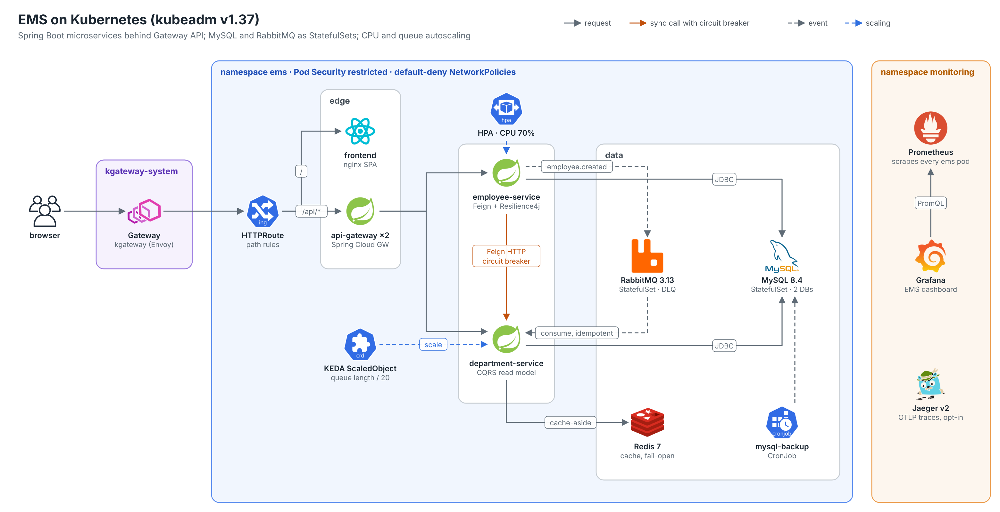

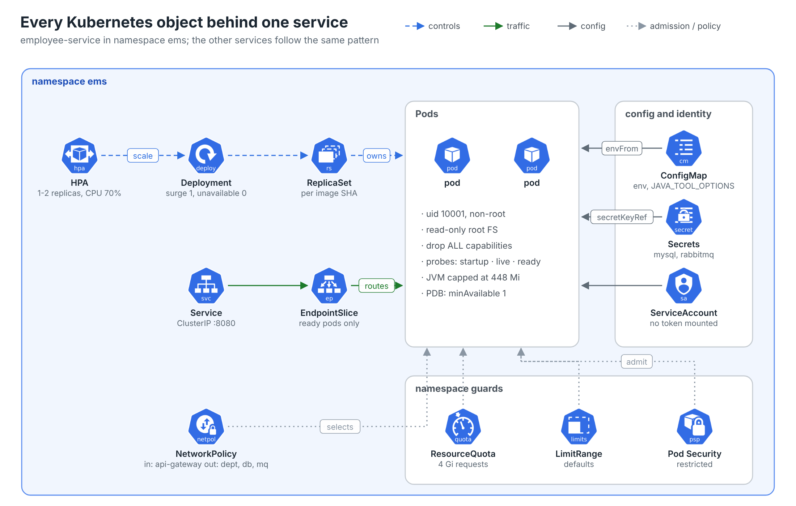

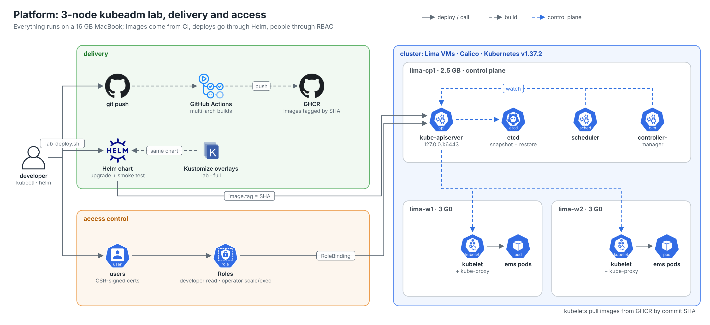

Generated by [`diagrams/k8s_diagrams.py`](diagrams/k8s_diagrams.py) (`pip install diagrams playwright`). The Mermaid diagrams below are the detailed, reviewable source.

## 1. System context

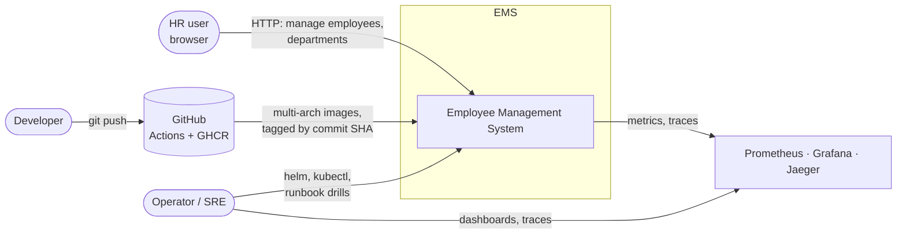

## 2. Containers

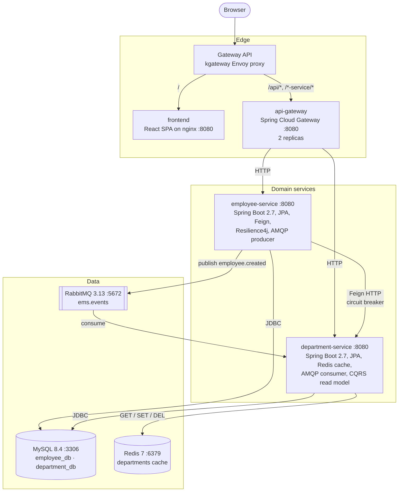

Each service owns its database: `employee` can only reach `employee_db`, and `department` only `department_db`. They share one MySQL server to save memory on the lab.

## 3. Read path: GET employee

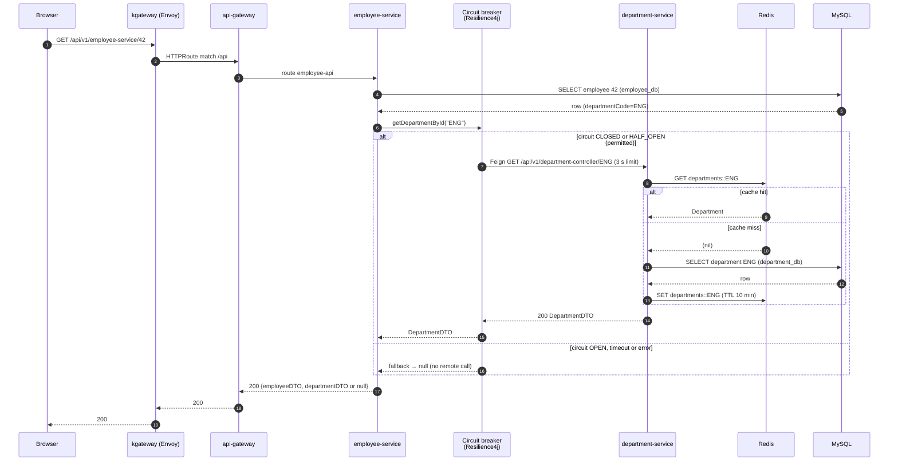

Measured: one traced request was 46–110 ms end to end, 10–14 spans across 3 services ([trace screenshot](img/trace.png)). Under k6 load, p95 was 13–25 ms.

## 4. Write path: POST employee

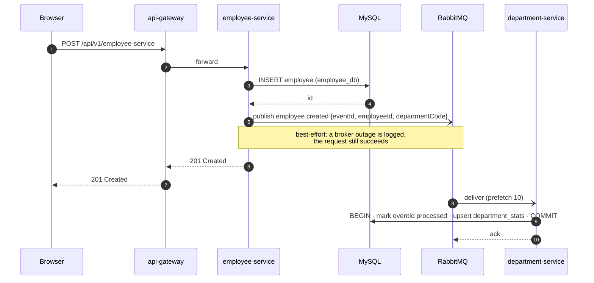

The HTTP response doesn't wait for the stats update: `GET /department-controller/ENG/stats` is eventually consistent. The trade-off between best-effort publishing and a transactional outbox is in [architecture.md](architecture.md#design-decisions-and-trade-offs).

## 5. Circuit breaker state machine

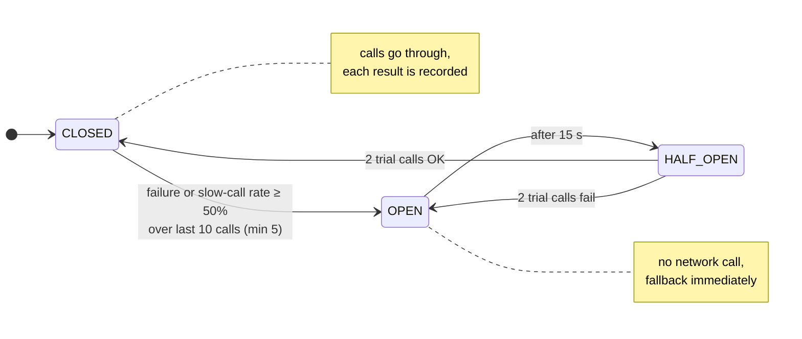

These settings come from `employee-service` `application.properties`:

| Setting | Value | Why |
|---|---|---|
| `sliding-window-type` / `size` | COUNT_BASED / 10 | Small and predictable on a lab with low traffic |
| `minimum-number-of-calls` | 5 | Don't trip on one or two early errors |
| `failure-rate-threshold` | 50% | Half the calls failing means the dependency is down |
| `slow-call-duration-threshold` / `rate` | 2 s / 50% | A slow dependency is treated like a failing one |
| `wait-duration-in-open-state` | 15 s | Gives department-service time to restart |
| `permitted-number-of-calls-in-half-open-state` | 2 | Cheap probe before reopening the floodgates |
| `timelimiter.timeout-duration` | 3 s | Matches Feign's read timeout; no thread waits longer |

Drill (`deploy/drills/section-e.sh`): KEDA paused department-service at 0 pods → employee GET kept returning 200 with `departmentDTO: null` → after scale-up, the circuit closed and department data came back.

## 6. Circuit breaker decision per call

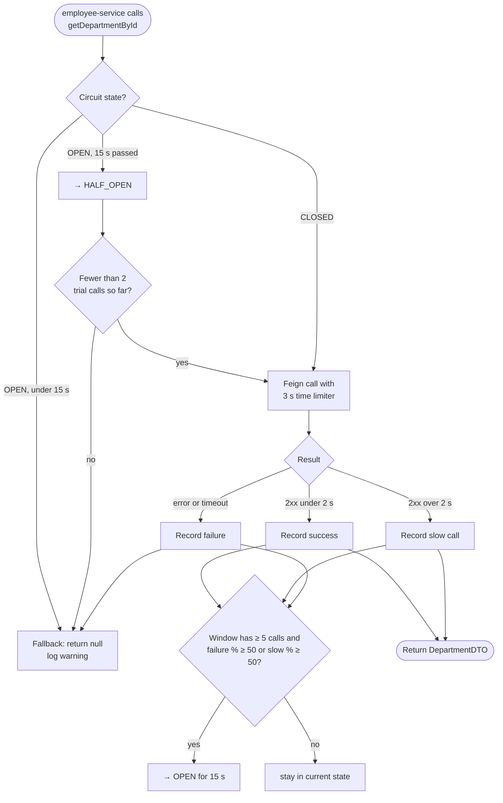

The fallback is graceful degradation: the employee is still returned, just without department details. The caller gets a 200 response, not a 500 or a 30-second hang.

## 7. Cache-aside with fail-open

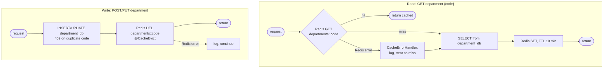

Redis is an optimisation, never a dependency. Its health check is disabled (`management.health.redis.enabled=false`), so a Redis outage never takes department pods out of the Service. Evicting instead of updating avoids a race where two writers leave the cache stale.

## 8. RabbitMQ topology

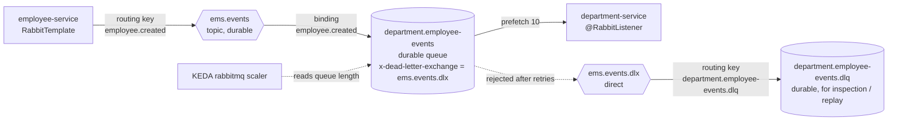

The topic exchange means a future consumer (for example, notifications) can bind `employee.*` without touching the producer.

## 9. Message lifecycle, retries and DLQ

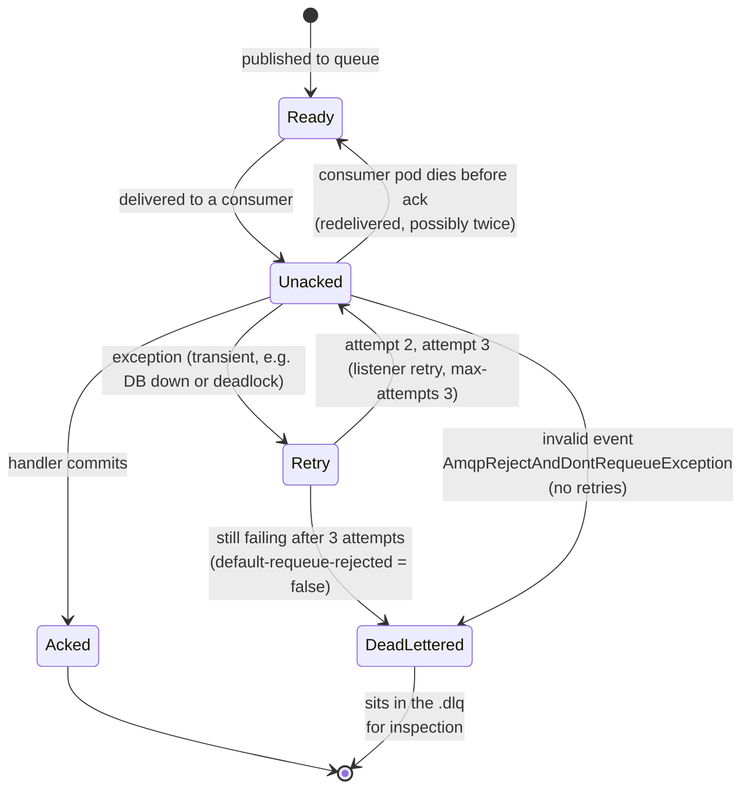

Two kinds of failure are handled on purpose:
- **Transient failures** are retried 3 times in the consumer.
- **Poison messages** go straight to the DLQ, so they can't block the queue.

Redelivery after a pod crash is the reason the consumer has to be idempotent.

## 10. Idempotent consumer

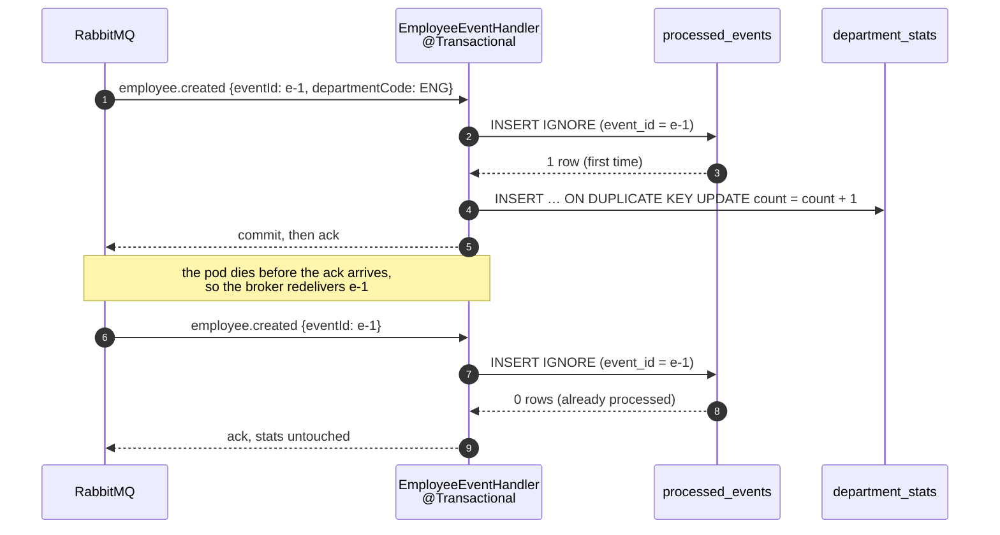

The dedupe row and the stats update commit in **one** database transaction, so either both happen or neither does. That is effectively-once processing on top of an at-least-once broker.

## 11. Data model

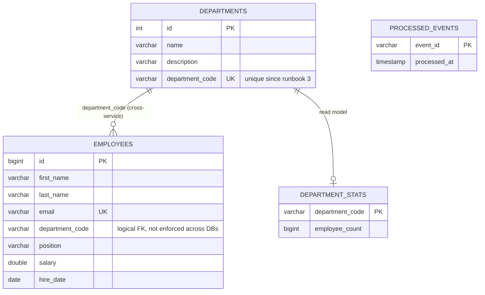

`employees` lives in `employee_db`; the other three tables live in `department_db`. The link between employees and departments is a code, not a foreign key. Each service owns its data, and the reference is checked over HTTP.

## 12. Cluster topology

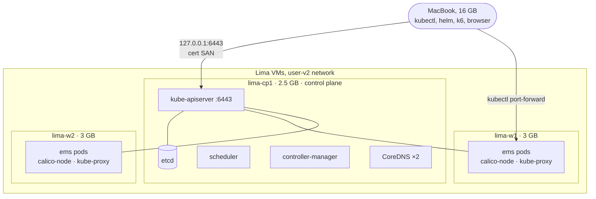

Namespaces:
- `ems`: the app, with Pod Security `restricted` enforced
- `monitoring`: Prometheus, Grafana, Jaeger
- platform: `keda`, `kgateway-system`, `calico-system`, `local-path-storage`

Kubernetes v1.37.2 (kubeadm), Calico (pod CIDR 10.244.0.0/16), metrics-server, local-path StorageClass, Gateway API v1.7 with kgateway v2.5, KEDA.

## 13. Kubernetes objects for one service

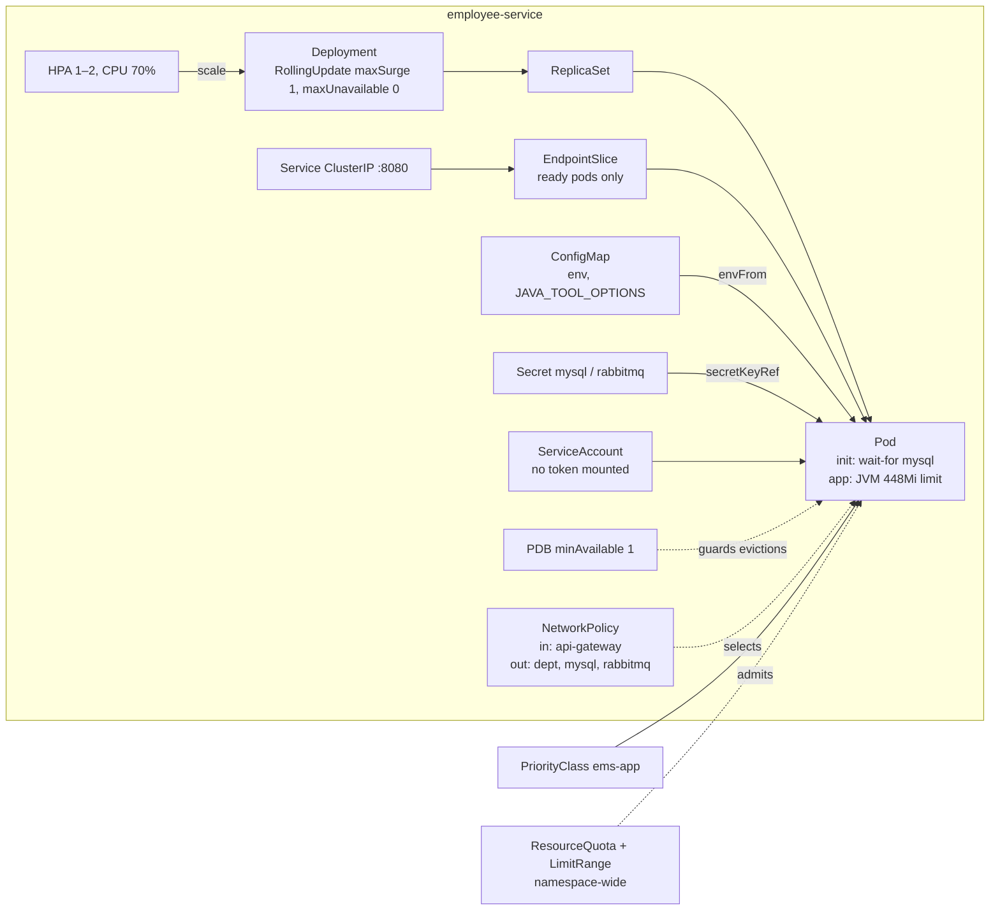

**Probes:**
- **startup:** liveness path, up to 4 minutes (JVM plus agent)
- **liveness:** `/actuator/health/liveness`
- **readiness:** `/actuator/health/readiness`, which includes the DB, plus RabbitMQ for department

**Pod security:** non-root uid 10001, read-only root filesystem except `/tmp`, all capabilities dropped, seccomp `RuntimeDefault`.

## 14. Traffic path

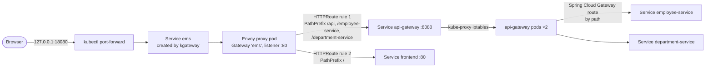

There are two routing layers on purpose:
- **Gateway API** does platform-level, path-based routing. It can be swapped for any implementation.
- **Spring Cloud Gateway** handles routing that belongs to the application.

## 15. NetworkPolicy allowed flows

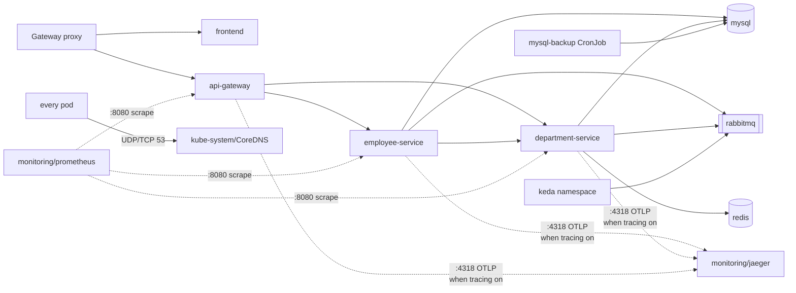

Everything else is denied in both directions (`default-deny-all`). Drill: a pod without an allow rule times out on MySQL, while api-gateway reaches employee-service. Runbook 11 shows what a single wrong port does to DNS.

## 16. CPU autoscaling (HPA)

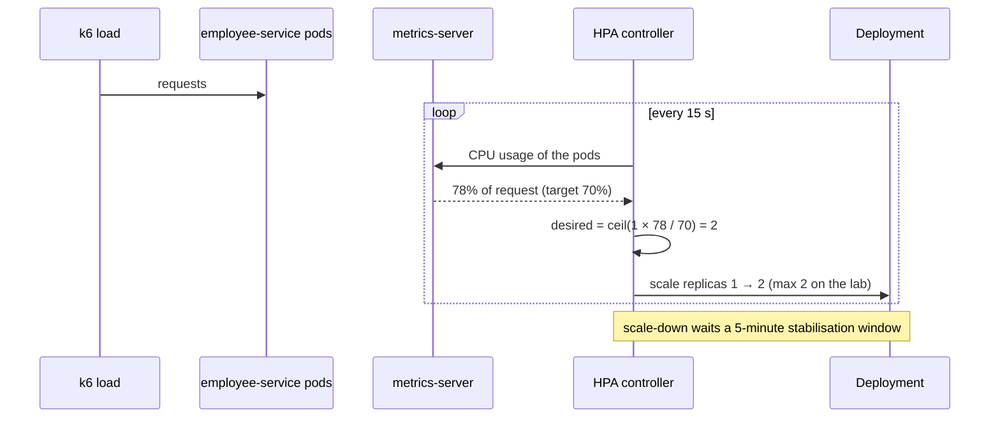

`desiredReplicas = ceil(currentReplicas × currentMetric / targetMetric)`. Measured in the drill: 1 → 2 at 78% CPU.

## 17. Queue autoscaling (KEDA)

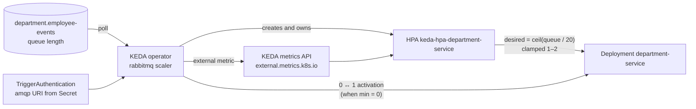

Measured in the drill: with an artificial consumer delay (`ems.events.consumer-delay-ms`), the queue reached 94 messages → 2 pods (`ceil(94 / 20) = 5`, capped at max 2), then drained to 0. The DLQ stayed empty.

## 18. Rolling update and node drain

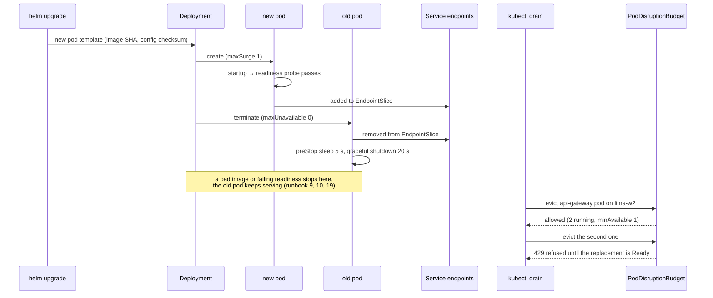

Drill: 103 of 103 requests succeeded while a node was drained.

## 19. Delivery pipeline

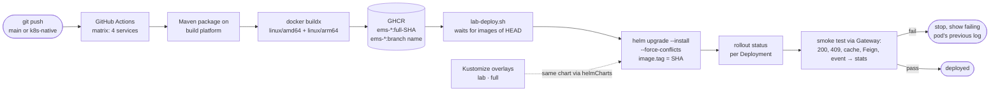

Images are tagged by commit SHA, never `:latest`, so a rollout always means a real change and is easy to roll back. Kustomize renders the same chart for other environments.

## 20. Observability data flow

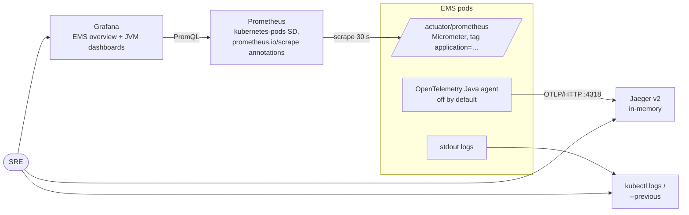

**What each signal answers:**
- **Metrics:** is it healthy? (rate, errors, latency, heap, CPU, pods per service, queue throughput)
- **Traces:** where did the time go?
- **Logs:** why did it fail?

Screenshots: [Grafana](img/grafana.png), [Jaeger](img/trace.png).

## 21. Security in depth

```mermaid
flowchart TB
  l1[Supply chain:<br/>images built in CI, pinned by SHA,<br/>non-root uid 10001] --> l2
  l2[Admission:<br/>Pod Security 'restricted' enforced,<br/>ResourceQuota + LimitRange] --> l3
  l3[Runtime:<br/>runAsNonRoot, no privilege escalation,<br/>drop ALL capabilities, seccomp RuntimeDefault,<br/>no ServiceAccount token mounted] --> l4
  l4[Network:<br/>default-deny NetworkPolicies,<br/>one allow rule per flow] --> l5
  l5[Identity:<br/>RBAC Roles; ems-developer read-only,<br/>ems-operator scale/exec, no Secrets;<br/>users via CSR-signed certs] --> l6
  l6[Secrets:<br/>Kubernetes Secrets, git-ignored values files,<br/>Kustomize secretGenerator; nothing in git]
```

## 22. Failure modes

| Failure | What users see | Why | Proof |
|---|---|---|---|
| department-service down | Employee pages load, department shows empty | Circuit breaker + fallback | section-e drill |
| department-service slow (> 3 s) | Same as down, after 3 s at most | Time limiter | config |
| Redis down | Everything works, a bit slower | Fail-open cache, Redis not in readiness | runbook 14 |
| RabbitMQ down | Employee create still 201; stats stop updating | Best-effort publish | design choice |
| Poison message | One message in the DLQ, the rest flow | Reject without requeue | `EmployeeEventHandler` |
| Duplicate delivery | Stats count once | Idempotent consumer | diagram 10 |
| Bad image / bad config | Nothing; the old pods keep serving | Rolling update with readiness gates | runbook 9, 10, 19 |
| Node lost or drained | Nothing for api-gateway (2 replicas, spread, PDB) | Topology spread + PDB | drain drill |
| DNS policy broken | New connections fail | Default-deny + explicit DNS allow | runbook 11 |
| CoreDNS down | New lookups fail cluster-wide | Single dependency | runbook 16 |
| MySQL down | Reads and writes fail; pods go not-ready | Single instance (lab) | scaling path |

## 23. Memory budget on the lab

```mermaid
pie showData title Measured memory (MiB) under load, namespace ems + monitoring
  "api-gateway ×2" : 463
  "employee-service" : 271
  "department-service" : 277
  "MySQL" : 222
  "RabbitMQ" : 114
  "Prometheus" : 246
  "Grafana" : 252
  "Gateway proxy + frontend + Redis" : 37
```

The JVMs are capped at 448 MiB (`MaxRAMPercentage=70`, SerialGC). The namespace quota is 4 GiB requests / 5 GiB limits, and 10 pods used 2.4 GiB of requests. Two 3 GB workers leave headroom for one extra replica per service.

## 24. Cluster operations

```mermaid
flowchart TB
  subgraph upgrade[kubeadm upgrade v1.36.6 → v1.37.2]
    u1[etcd snapshot first] --> u2[cp1: kubeadm upgrade plan / apply]
    u2 --> u3[cp1: kubelet + kubectl, restart]
    u3 --> u4[each worker: drain → kubeadm upgrade node<br/>→ kubelet → uncordon]
    u4 --> u5[PDBs hold during drains,<br/>EMS stays up]
  end
  subgraph etcd[etcd backup and restore]
    e1[etcdctl snapshot save] --> e2[delete a marker object]
    e2 --> e3[snapshot restore to a new data dir]
    e3 --> e4[point the static pod at it,<br/>marker is back]
    e4 --> e5[swap the data dir back,<br/>fix peer URL before the next upgrade]
  end
  subgraph certs[Certificates]
    c1[kubeadm certs check-expiration] --> c2[kubeadm certs renew apiserver]
    c2 --> c3[move the static pod manifest out and back]
    c3 --> c4[served notAfter = file notAfter]
  end
```

## 25. Scaling path

```mermaid
flowchart LR
  now[Lab today<br/>1 MySQL, 1 RabbitMQ, 1 Redis<br/>HPA/KEDA max 2] --> x10
  x10["10×<br/>managed MySQL with read replica,<br/>RabbitMQ quorum queues (3 nodes),<br/>Redis replica, HPA/KEDA max 6–8<br/>(Kustomize 'full' overlay)"] --> x100
  x100["100×<br/>transactional outbox + CDC instead of best-effort publish,<br/>separate DB servers per service,<br/>Kafka for the event log, rate limits at the Gateway,<br/>multi-AZ nodes, HA control plane"]
```

The trade-offs at each step are discussed in [architecture.md](architecture.md#scaling-path-what-would-change-at-100x).
